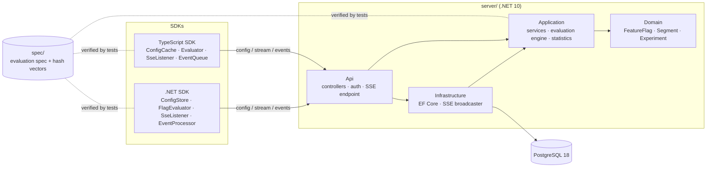
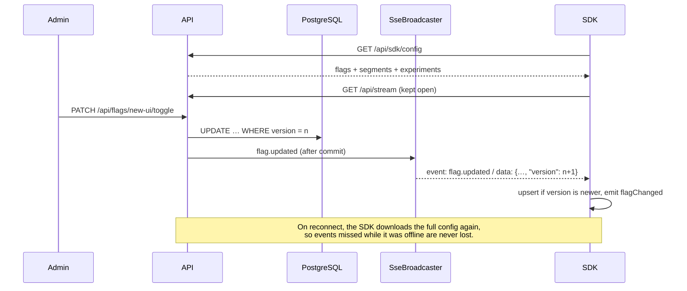

# FeatureFlare

[](https://github.com/blayner/FeatureFlare/actions/workflows/ci.yml)

Feature flags and A/B experiments platform: a .NET 10 server plus SDKs for **.NET** and **TypeScript**. The
SDKs evaluate flags **locally** against a cached copy of the configuration and receive changes in real
time over **Server-Sent Events**.

```
┌────────────┐   GET /api/sdk/config (once)      ┌──────────────────────┐
│  Your app  │ ───────────────────────────────▶  │   FeatureFlare API   │
│  + SDK     │ ◀─────────────────────────────── │   (.NET 10)          │
│            │   GET /api/stream (SSE, live)     │                      │
│ evaluate() │                                   │  flags · segments    │
│  locally   │ ──── POST /api/events (batched) ▶ │  experiments · stats │
└────────────┘                                   └──────────┬───────────┘
                                                            │ EF Core
                                                      ┌─────▼─────┐
                                                      │ Postgres  │
                                                      └───────────┘
```

## Contents

- [Features](#features)
- [Architecture](#architecture)
- [Evaluation](#evaluation)
- [Quick start](#quick-start)
- [API overview](#api-overview)
- [Architecture decisions](#architecture-decisions)
- [Testing](#testing)
- [Known limitations and roadmap](#known-limitations-and-roadmap)

## Features

- **Typed flags**: boolean, string, number and JSON, with any number of variations.
- **Targeting rules**: ordered rules with clauses on any context attribute: `in`, `contains`, `startsWith`,
  `endsWith`, `matches` (regex), numeric comparisons, semantic-version comparisons and `inSegment`.
- **Segments**: reusable audiences with explicit include/exclude lists and attribute rules.
- **Percentage rollouts**: deterministic, sticky bucketing (MurmurHash3), optionally by another attribute
  (for example, roll out per `companyId` instead of per user).
- **A/B/n experiments**: traffic allocation, weighted variants, a design that is frozen once the experiment
  starts, exposure and conversion tracking, and results with a two-proportion z-test against the control.
- **Real-time updates**: SSE stream with heartbeats, version-ordered upserts and a full re-sync on reconnect.
- **SDKs** for TypeScript (Node ≥ 22, browsers) and .NET 10, with **identical** evaluation, verified by
  shared test vectors.

## Architecture



| Layer | Responsibility |
|-------|----------------|
| **Domain** | Aggregates that enforce their invariants. Every mutation validates the complete new state *before* assigning it, so a rejected change never leaves an aggregate half-updated. |
| **Application** | Use cases (flags, segments, experiments, event ingestion, results), the pure evaluation engine, and the wire contract consumed by the SDKs. |
| **Infrastructure** | EF Core/PostgreSQL (value objects stored as `jsonb`), an in-memory provider for development and tests, and the SSE broadcaster. |
| **Api** | Thin controllers, API-key authentication with two key types, and RFC 7807 problem details. |

### Change propagation



## Evaluation

The algorithm is specified in [`spec/README.md`](spec/README.md) and implemented three times (server,
TypeScript, .NET):

1. Flag disabled → serve the `offVariation`.
2. Rules in order; the first rule whose clauses **all** match serves its variation or rollout.
3. Otherwise serve the `fallthrough`.

Bucketing is `murmur3_x86_32(utf8("{key}.{salt}.{value}")) % 10000`. Experiments use separate salts for
the traffic gate and for the variant split, so increasing traffic from 10% to 50% only **adds** users;
nobody already in the experiment switches variant (covered by a test).

[`spec/hash-vectors.json`](spec/hash-vectors.json) holds reference hashes, including multi-byte UTF-8
input. All three test suites load the same file.

## Quick start

### Run the server

```bash
# Option 1: in-memory store, development keys (dev-admin-key / dev-sdk-key)
dotnet run --project server/src/FeatureFlare.Api

# Option 2: full stack with PostgreSQL 18 (keys: local-admin-key / local-sdk-key)
docker compose up --build
```

Requires the .NET 10 SDK (see `global.json`). In Development, the OpenAPI document is served at
`/openapi/v1.json`.

### Create a flag

```bash
curl -X POST http://localhost:5000/api/flags \
  -H "X-Api-Key: dev-admin-key" -H "Content-Type: application/json" \
  -d '{
    "key": "new-checkout",
    "name": "New checkout",
    "type": "boolean",
    "variations": [{ "key": "on", "value": true }, { "key": "off", "value": false }],
    "offVariation": "off",
    "fallthrough": { "rollout": { "variations": [
      { "variation": "on", "weight": 1000 }, { "variation": "off", "weight": 9000 } ] } },
    "rules": [{
      "id": "beta-testers",
      "clauses": [{ "attribute": "plan", "operator": "in", "values": ["enterprise"] }],
      "serve": { "variation": "on" }
    }],
    "enabled": true
  }'
```

### TypeScript

```ts
import { FeatureFlareClient } from '@featureflare/sdk';

const client = new FeatureFlareClient({ apiKey: 'dev-sdk-key', baseUrl: 'http://localhost:5000' });
await client.initialize();

const enabled = client.getBooleanValue('new-checkout', false, { userId: 'u-123', attributes: { plan: 'enterprise' } });
client.on('flagChanged', (key) => console.log(`${key} changed`));
```

### .NET

```csharp
builder.Services.AddFeatureFlare(builder.Configuration); // binds the "FeatureFlare" section

app.MapGet("/checkout", (IFeatureFlareClient flags, ClaimsPrincipal user) =>
{
    var context = new EvaluationContext(user.FindFirstValue("sub")!) { { "plan", "enterprise" } };
    return flags.GetBooleanValue("new-checkout", false, context) ? "new" : "old";
});
```

See [`sdks/typescript/README.md`](sdks/typescript/README.md) and [`sdks/dotnet/README.md`](sdks/dotnet/README.md).

## API overview

| Method | Path | Key | Purpose |
|--------|------|-----|---------|
| `GET/POST` | `/api/flags` | admin | List and create flags |
| `GET/PUT/DELETE` | `/api/flags/{key}` | admin | Read, replace (optional `expectedVersion`) and delete |
| `PATCH` | `/api/flags/{key}/toggle` | admin | Enable or disable |
| `POST` | `/api/flags/{key}/evaluate` | admin | Explain an evaluation for a context |
| `GET/POST/PUT/DELETE` | `/api/segments[/{key}]` | admin | Segment CRUD (deleting a segment in use returns 409) |
| `GET/POST/PUT/DELETE` | `/api/experiments[/{key}]` | admin | Experiment CRUD |
| `POST` | `/api/experiments/{key}/start` · `pause` · `conclude` | admin | Lifecycle |
| `PUT` | `/api/experiments/{key}/traffic` | admin | Ramp traffic up or down |
| `GET` | `/api/experiments/{key}/results?metric=&alpha=` | admin | Per-variant statistics |
| `GET` | `/api/sdk/config` | sdk | Full configuration for local evaluation |
| `GET` | `/api/stream` | sdk | SSE stream of changes |
| `POST` | `/api/evaluate[/{key}]` | sdk | Server-side evaluation (for untrusted clients) |
| `POST` | `/api/events` | sdk | Batched exposures and conversions |

Errors use RFC 7807: `404` not found, `409` conflict, `412` version mismatch, `422` invalid configuration.

## Architecture decisions

Full records are in [`docs/adr`](docs/adr):

| ADR | Decision |
|-----|----------|
| [0001](docs/adr/0001-sse-over-websockets.md) | **SSE instead of WebSockets** for change propagation |
| [0002](docs/adr/0002-local-evaluation.md) | **Local evaluation in SDKs**, with server-side evaluation only for untrusted clients |
| [0003](docs/adr/0003-hash-based-bucketing.md) | **MurmurHash3 bucketing** shared across languages and verified by test vectors |
| [0004](docs/adr/0004-jsonb-value-objects.md) | **jsonb columns** for rules and variations instead of a normalized schema |

### Design goals

These are targets that drove the design. They have **not** been benchmarked yet:

- Flag evaluation in the SDKs needs no I/O and should take well under a millisecond.
- A change should reach connected SDKs within a fraction of a second on a single node.
- A FeatureFlare outage must never break the host application: SDKs keep serving the last known
  configuration, or the caller's defaults.

## Testing

```bash
dotnet test server/FeatureFlare.sln         # domain + API integration tests (xunit.v3, Shouldly)
dotnet test sdks/dotnet/FeatureFlare.Sdk.sln
cd sdks/typescript && npm ci && npm test    # vitest
```

Highlights:

- Shared MurmurHash3 and bucket vectors in all three implementations.
- Distribution tests for rollouts and experiment weights, and stickiness when traffic is ramped up.
- API tests with `WebApplicationFactory`: auth (SDK keys can't write; admin keys aren't accepted in query
  strings), validation, optimistic concurrency, segment referential integrity, and the full experiment flow.
- SSE: slow subscribers are disconnected instead of silently losing events; the parser handles chunked
  CRLF input.

## Known limitations and roadmap

- **Single node streaming.** `SseBroadcaster` is in-process. Running several API replicas needs a backplane
  (Postgres `LISTEN/NOTIFY` or Redis pub/sub). See ADR 0001.
- **Schema creation** uses `EnsureCreated` (`Persistence:AutoCreateSchema`). Production should use
  versioned EF Core migrations.
- **No environments or projects yet.** Every key sees one configuration.
- **Statistics** use a fixed-horizon frequentist test. Peeking at results repeatedly inflates false
  positives; sequential testing or a Bayesian model is on the roadmap.
- **No audit log or UI.** Management is API-only.

## License

MIT
